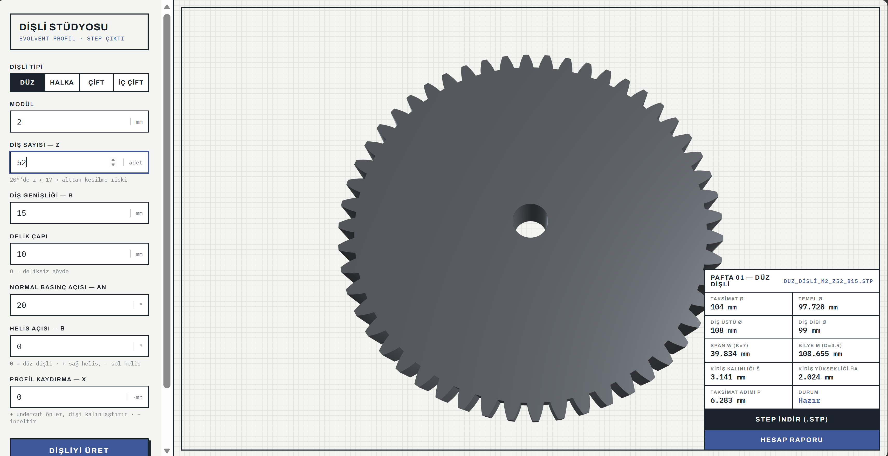

# Dişli Stüdyosu: Parametric Involute Gear Generator

A local web application that turns gear parameters into **manufacturing ready STEP models**, with live 3D preview, inspection dimensions and an ISO 6336 strength check.

I built it because modeling gears with a specific module, profile shift or helix angle by hand in Siemens NX is slow and error prone. Here you enter the parameters, check the geometry in 3D and download a STEP file you can drop straight into any CAD assembly.

> The user interface is in Turkish. The code, parameters and outputs follow standard gear terminology (ISO 21771, ISO 6336, DIN 3990).



## Features

**Geometry (CadQuery, exported as STEP)**
- External spur and helical gears (helix angle up to ±45°)
- Internal ring gears with configurable rim width
- External gear pairs and pinion + ring gear pairs, positioned at the correct operating center distance
- Module, tooth count, face width, pressure angle (14° to 25°), profile shift, bore

**Inspection dimensions** (Jelaska, *Gears and Gear Drives*, §2.6.7)
- Span measurement W<sub>k</sub> over k teeth, including a check that the face width is sufficient for span measurement
- Dimension over balls/pins M
- Chordal tooth thickness

**Strength (ISO 6336 / DIN 3990)**
- Contact (pitting) and tooth root bending safety factors
- Tooth root geometry by ISO 6336-3 Method C (30° tangent section, load at the tip) on the ISO 53 basic rack
- Validated against the DIN 3990 charts: z = 20, x = 0 gives Y<sub>Fa</sub> = 2.800 and Y<sub>Sa</sub> = 1.553
- Material library: C45, 42CrMo4 (quenched and tempered), 16MnCr5 and 18CrNiMo7-6 (case hardened), GG25 cast iron

**Interface**
- Three.js 3D preview of the generated part
- Printable calculation report

## How it works

```
Browser (Three.js UI)  ──►  FastAPI  ──►  CadQuery + cq_gears  ──►  STEP file
                                └──►  analytic core: involute geometry, inspection
                                      dimensions, ISO 6336 strength
```

| File | Purpose |
|---|---|
| `app.py` | FastAPI server: geometry generation, inspection dimensions, strength calculation |
| `static/index.html` | User interface: parameter form, 3D preview, strength panel, report |

## Running locally

Requires Python 3.11 or newer.

```bash
git clone https://github.com/<your-username>/disli-studyo.git
cd disli-studyo
python -m venv .venv
.venv\Scripts\activate          # Windows  (macOS/Linux: source .venv/bin/activate)
pip install -r requirements.txt
python app.py
```

The browser opens automatically at `http://127.0.0.1:8000`. The first install downloads CadQuery and its OpenCascade kernel, which is several hundred MB.

## Lessons from generating CAD automatically

Building this taught me where parametric geometry generation breaks, and why every generated model still needs an engineer's check:

- **Valid parameters can still give an invalid part.** A low tooth count without enough profile shift produces undercut; too much positive shift gives a pointed tip. The model exports fine but the gear is unusable, so input ranges alone are not enough and the geometry itself must be checked.
- **Pairs must be checked as a system.** Two gears that are each valid can still mesh incorrectly. Center distance, working pressure angle and the sum of profile shifts all have to agree.
- **A model is only finished when it can be inspected.** Span and over ball dimensions are what the workshop actually measures, so they are generated alongside the STEP file instead of being left for later.
- **Calculations need validation against a reference.** The tooth root factors were checked against the published DIN 3990 values before trusting any safety factor.

## References

- D. Jelaska, *Gears and Gear Drives*, Wiley, 2012
- ISO 6336 (Parts 1 to 5), DIN 3990, ISO 53, ISO 21771
- [cq_gears](https://github.com/meadiode/cq_gears) for the base involute tooth geometry

## Author

**Behçet Utku Yaşar**, M.Sc. Mechanical Engineering student at TUM
[LinkedIn](https://www.linkedin.com/in/behcet-utku-yasar/)
